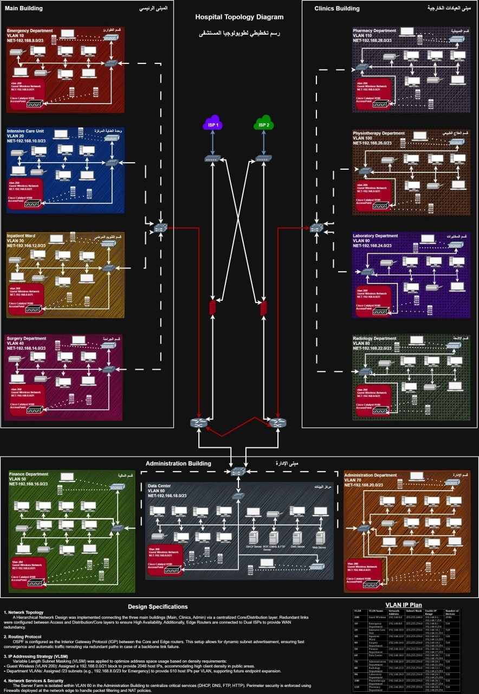
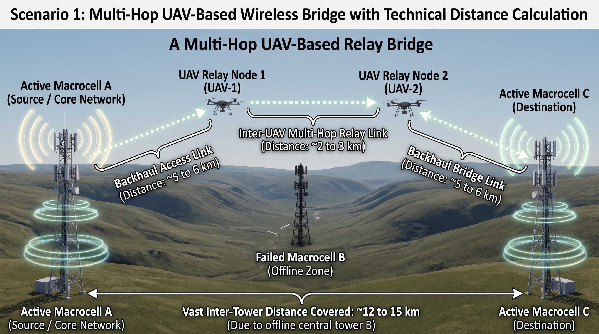
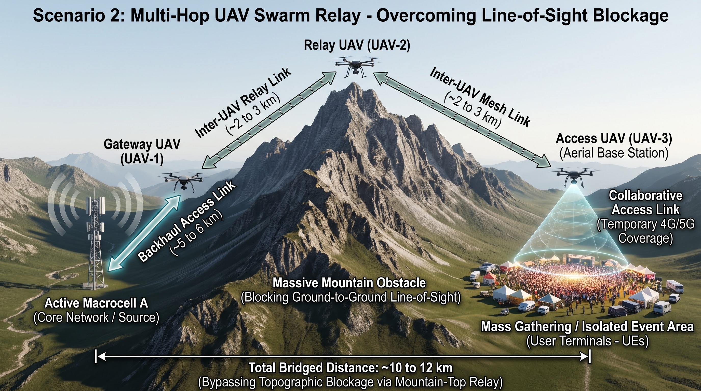
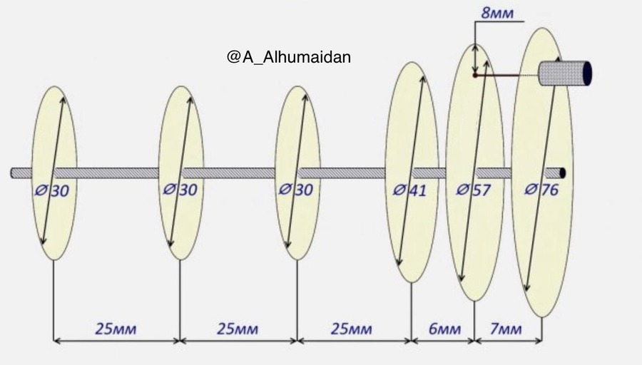
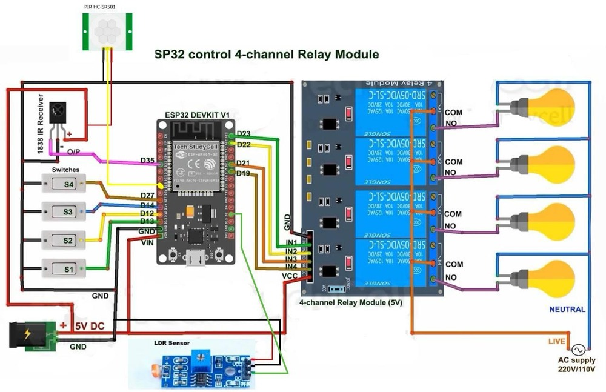

# Hi, I'm Abdullah Alhumaidan 👋

### 🌐 Computer Network Engineering Student

**Networking & Routing • Embedded Systems • UAV Technology • Software Development**

---

## 👨‍💻 About Me

I'm a **Computer Network Engineering student** interested in connecting **networking, software, and hardware** through practical engineering projects.

My interests include network infrastructure, wireless communication, embedded systems, UAV technology, and electronics.

- 🌐 **Networking:** Routing, switching, and network infrastructure
- 💻 **Programming:** Python, Java, JavaScript, C, and C++
- 🖥️ **Hardware:** Working with Orange Pi 4
- 🔌 **Embedded Systems:** Exploring microcontrollers and hardware integration
- 🚁 **Current Focus:** UAV communications and aerial cellular networks
- 🔬 **Engineering Interests:** Wireless systems, IoT, semiconductors, and electronics

---

## 🛠️ Technologies & Tools

### 💻 Programming Languages

### 🌐 Networking & Development Tools

---

# 🚀 Selected Engineering Projects

A collection of academic and practical engineering projects involving computer networks, wireless systems, and embedded technologies.

---

## 🏥 01 · Hospital Network Infrastructure

**Network Design & Simulation**

  

### Hospital Network Infrastructure Design & Implementation

Designed and simulated a **three-building hospital network** connecting the main hospital, outpatient clinics, and administration and data center facilities.

The project focuses on developing a structured, reliable, and scalable network infrastructure using routing, switching, VLAN segmentation, redundancy, and network services.

**Technical Highlights**

- Hierarchical network infrastructure design
- VLAN segmentation and inter-VLAN routing
- OSPF dynamic routing
- DHCP and IP addressing
- Redundancy and network availability
- Network connectivity and performance testing

**Technologies**

`Cisco Packet Tracer` `draw.io` `VLAN` `OSPF` `DHCP` `Routing & Switching`

📄 **[View Project Details](./projects/hospital-network/README.md)**

---

## 🚁 02 · Multi-UAV Aerial Cellular Network

**🎓 Graduation Project — In Progress**

### Design and Implementation of a Multi-UAV Aerial Cellular Network for Emergency Connectivity and Coverage Restoration

An ongoing graduation project exploring a cooperative **UAV-based aerial cellular network** intended to restore communication coverage during terrestrial network failures and extend connectivity to isolated geographical areas.

The proposed architecture investigates the deployment of multiple UAVs operating as gateway, relay, and access nodes to establish temporary aerial communication links.

### 📡 Scenario 1 — Emergency Cellular Coverage Restoration

  

**Multi-Hop UAV-Based Wireless Bridge**

This scenario investigates the use of cooperating UAVs to establish wireless relay links when a terrestrial cellular base station becomes unavailable.

The proposed system explores temporary aerial communication infrastructure to bridge connectivity gaps and support communication continuity during network outages.

**Key Concepts**

`Cellular Networks` `Wireless Backhaul` `Multi-Hop Relays` `UAV Communication` `Network Resilience`

---

### 🛰️ Scenario 2 — Multi-Hop UAV Relay Network

  

**Extended Wireless Coverage Across Geographical Obstacles**

This scenario investigates deploying multiple UAVs to establish wireless connectivity across challenging terrain, including mountains, valleys, and remote locations.

The proposed architecture uses gateway, relay, and access UAVs to form an aerial communication path between an operational terrestrial network and an isolated service area.

**Key Concepts**

`UAV Swarms` `Wireless Relay Networks` `Line-of-Sight` `Aerial Networks` `Emergency Connectivity`

---

**Graduation Project Focus**

- UAV-based communication architectures
- Emergency cellular coverage restoration
- Multi-hop aerial relay networks
- Wireless backhaul connectivity
- Communication across terrain obstacles
- Network resilience and service continuity

*The diagrams represent conceptual engineering scenarios for an ongoing graduation project.*

📄 **[View Graduation Project Overview](./projects/multi-uav-cellular-network/README.md)**

---

## 🔌 03 · Portable Network Antenna

**Antenna Design & Fabrication**

### Portable Network Antenna Design and Manufacturing

A student engineering project focused on designing and fabricating a portable antenna setup intended to improve network connectivity in areas with weak cellular signals.

The project explores antenna design, mechanical integration, and low-cost fabrication using 3D printing.

<table>
  <tr>
    <td width="50%" align="center">
      
       
      <strong>Antenna Prototype</strong>
    </td>
    <td width="50%" align="center">
      
       
      <strong>Antenna Design</strong>
    </td>
  </tr>
</table>

**Technical Highlights**

- Portable antenna concept
- Antenna structure and mechanical design
- 3D modeling and fabrication
- Integration of wireless communication components
- Exploration of connectivity in remote locations

**Technologies**

`Antenna Design` `SolidWorks` `3D Printing` `Wireless Networks`

📄 **[View Project Details](./projects/portable-network-antenna/README.md)**

---

## 💡 04 · Arduino Smart Lighting System

**Embedded Systems & Microcontrollers**

### Multiple Methods for Controlling a Lighting System Using Arduino

An academic embedded systems project exploring multiple approaches for controlling electrical lighting using microcontrollers, sensors, and wireless communication.

The system explores lighting control using Arduino, infrared remote commands, motion detection, and wireless connectivity.

<table>
  <tr>
    <td width="50%" align="center">
      
       
      <strong>Lighting System Prototype</strong>
    </td>
    <td width="50%" align="center">
      
       
      <strong>Circuit Schematic</strong>
    </td>
  </tr>
</table>

**Technical Highlights**

- Arduino-based lighting control
- Infrared remote communication
- PIR motion sensor integration
- Light-dependent sensing
- Relay-based switching
- Wireless control using NodeMCU

**Technologies**

`Arduino` `Embedded Systems` `PIR` `IR Remote` `NodeMCU` `Relay Modules`

📄 **[View Project Details](./projects/arduino-smart-lighting/README.md)**

---

## 🔬 Engineering & Technology Interests

| Field | Technologies & Areas of Interest |
|:---|:---|
| 🌐 **Network Engineering** | Network Design, Routing, Switching, Infrastructure |
| 📡 **Wireless Communication** | Wireless Networks, Radio Links, Communication Protocols |
| 🔌 **Microcontrollers** | STM32, ESP32, ARM Cortex-M, Arduino |
| ⚙️ **Embedded Systems** | Embedded Linux, Hardware Integration |
| 🖥️ **Single-Board Computers** | Orange Pi 4, ARM-Based Platforms |
| 🚁 **UAV Technology** | UAV Communications, Aerial Networks, Drone Systems |
| 🔬 **Semiconductors** | Integrated Circuits, Semiconductor Devices, Electronics |
| 🌍 **IoT** | Connected Devices, Wireless Integration |
| 💻 **Software Development** | Python, Java, JavaScript, C, C++ |

These areas represent my technical interests and ongoing learning, rather than claims of advanced professional experience.

---

### 🌌 Connecting Networks. Exploring Hardware. Building with Code.

**Networking • Embedded Systems • Wireless Communication • UAV Technology**

⭐ **Thanks for visiting my profile!**

